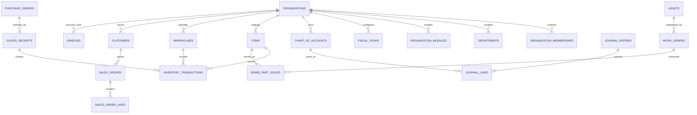

# MIDRICIFY Database Relationship & Migration Design
**Status:** Design baseline; no new database objects are created by this document.  
**Inspected database:** MIDRICIFY-Test (`natigtvdhllinlkdvjzn`)  
**Inspection date:** 2026-11-25

## 1. Existing foundation observed

The inspected test database contains tenant-scoped organizations, profiles, departments, memberships, permissions, role permissions, organization role permissions, audit logs, invitations, purchase requests and approvals, vendors, purchase orders and approvals, goods receipts, AP invoices/payments, department budgets, budget transfers, expense requests, inventory stock, RFQs, RFQ items, RFQ vendors, vendor quotations and quotation items.

All inspected public tables reported RLS enabled. This is a useful baseline, not proof that every policy is correct. Existing migrations are recorded through the RFQ/vendor-comparison and workspace-role-grant changes. Production database migration parity has not been established.

## 2. Architecture decision: preserve existing tables and extend incrementally

Do not replace or rename existing procurement tables as part of the ERP expansion. Add new domains with explicit foreign keys to existing organizations, profiles, departments, vendors and item masters. Where an existing table is already the correct canonical record, extend it through a reviewed migration rather than introducing a parallel copy.

### Relationship overview

This is a conceptual map, not executable DDL. Actual constraints and table names must be reconciled with the current migration history before SQL is authored.

## 3. Canonical modelling decisions

### Tenant identity
- Every organization-owned business table carries a non-null `organization_id`.
- Use composite unique keys where needed (for example `UNIQUE (organization_id, code)`).
- Child tables should either carry `organization_id` and enforce matching parent organization, or inherit tenant scope through a parent FK plus a database-enforced parent check. For high-risk financial/inventory tables, explicit tenant keys and composite foreign keys are preferred.
- Never trust a client-provided tenant identifier without resolving the authenticated user's active membership server-side.

### Parties, customers and vendors
- Keep the existing `vendors` table as the procurement supplier profile unless schema review reveals a compelling reason to migrate.
- Introduce a canonical `parties` identity only after checking whether existing vendor fields/data can be safely migrated. Customer and supplier roles may belong to one legal entity.
- Keep customer-specific credit limits, price lists and receivables settings separate from vendor payment terms.
- Do not duplicate suppliers when they become customers.

### Items and units
- Introduce an organization-scoped item/service master with SKU, item type, description, category, base unit, active status and inventory policy.
- Unit-of-measure conversions must be explicit, organization-scoped or globally controlled, and immutable once referenced by posted transactions (version or effective date if conversions change).
- Inventory-controlled items, non-stock items, services and fixed assets must be distinguishable.

### Inventory ledger
- Treat stock movements as an append-only transaction ledger: receipt, issue, transfer dispatch, transfer receipt, return, adjustment, production consumption and production output.
- Store source document type/id, warehouse/bin, item, quantity, unit, lot/serial, transaction timestamp, actor and valuation references.
- Do not allow normal UI actions to overwrite on-hand balances directly.
- Use reservations separately from physical stock movement.
- Prevent negative stock by default; any policy exception must be explicitly authorized and audited.
- Reconcile derived stock balances to the movement ledger.

### Finance ledger
- Journal header and lines are separate.
- Posted journals must balance per currency/base-currency rules, reference their source document and be immutable.
- Corrections use reversal journals; no destructive edits to posted entries.
- Enforce fiscal-period status at posting time.
- Maintain source document IDs and idempotency keys to prevent duplicate posting.
- AP/AR subledgers reconcile to control accounts.
- Inventory valuation postings reconcile to inventory control accounts.

## 4. Proposed migration groups

| Migration group | Objects / changes | Dependencies |
|---|---|---|
| A. Platform catalogue | module catalogue, industry editions, organization module entitlements, edition settings | organizations |
| B. Finance foundation | fiscal years/periods, chart of accounts, cost centres, journal headers/lines, posting controls | organizations, memberships, permissions |
| C. Shared master data | item master, categories, UOM and conversions, customer/party model after vendor review | organizations, existing vendors |
| D. Warehouse foundation | warehouses, bins, lots, serials, movement ledger, reservations, transfer documents | item master |
| E. Inventory valuation | cost layers/valuation, landed-cost allocation, GL integration | warehouse ledger, finance |
| F. Sales and distribution | customers/outlets, territories, representatives, orders, dispatch, collections | item master, inventory, finance |
| G. Assets and CMMS | asset register, maintenance plans, work orders, technician tasks, downtime, spare-part issues | inventory, finance |
| H. Manufacturing and quality | BOM, routing, production orders, material issues/output, inspections/nonconformance | inventory, finance, assets |
| I. Industry configuration | edition defaults, templates, role presets, reports and setup wizard | module catalogue and relevant domains |

Do not combine all domains into one large migration. Each migration should be small, reversible where practical, reviewed and independently testable.

## 5. Module catalogue and entitlements

Proposed module keys:
- `core`
- `procurement`
- `finance_accounting`
- `inventory_advanced`
- `sales_distribution`
- `maintenance_cmms`
- `manufacturing`
- `quality_management`
- `hr_payroll`
- `fleet_logistics`
- `projects_construction`
- `analytics_advanced`

Edition presets:
- `general_business`
- `manufacturing`
- `distribution_wholesale`
- `retail`
- `construction`
- `agriculture_agribusiness`

An organization can enable optional modules only if the subscription grants the entitlement and dependencies are active. Deactivation must preserve historical data and provide an explicit read-only/retention policy.

## 6. RLS and Data API requirements

Supabase announced that, from 2026-10-30, new public-schema tables are no longer automatically exposed to the Data API. Therefore every new public table migration must make an explicit decision about:
- whether the table needs Data API access at all;
- explicit `GRANT` statements to the minimum required roles when access is needed;
- RLS enabled before access is granted;
- policies scoped to active organization membership and required permissions;
- no broad `USING (true)` policy for tenant data.

Prefer server-side access for sensitive financial posting and inventory mutation. Use SECURITY INVOKER by default. If SECURITY DEFINER is essential, set a fixed safe `search_path`, validate `auth.uid()` and tenant membership inside the function, revoke default PUBLIC execution, grant only to the intended role, and run advisors.

Views exposed to the Data API must use `security_invoker = true` on supported PostgreSQL versions, or be kept inaccessible to untrusted roles.

## 7. Concurrency and correctness controls

- Use database sequences or atomic counter rows for document numbers; do not use count-plus-one.
- Use transactions and row locks for stock allocation, posting, payment application and approval transitions.
- Add idempotency keys to webhook and external integration entry points.
- Use unique constraints for source-document posting and external reference numbers.
- Store quantities and money in appropriate numeric types; never floating-point for financial amounts.
- Record transaction currency, base currency and exchange rate snapshot.
- Define explicit rounding policy per currency and journal.
- Use immutable event/audit history for privileged changes.

## 8. Migration delivery checklist

For each migration:
1. Inspect current table definitions, policies, functions, triggers and migration history.
2. Generate a new migration using the installed Supabase CLI workflow; do not invent migration timestamps or assume the hosted DB history is synchronized.
3. Test against a disposable/dev database first.
4. Confirm all public tables have RLS and explicit Data API exposure/grants decisions.
5. Test authorized and unauthorized users from at least two organizations.
6. Test unique constraints, FK tenant boundaries, concurrent posting and rollback behavior.
7. Run Supabase security and performance advisors.
8. Commit the migration and application code together where possible.
9. Apply to production only after explicit release approval and backup/rollback review.
10. Verify schema, migration history, app build and end-to-end behavior after release.

## 9. Open verification items

- Confirm exact production Supabase project reference and migration history.
- Compare production schema to MIDRICIFY-Test and repository migrations.
- Inspect all current RLS policies and SECURITY DEFINER functions, not only RLS enabled flags.
- Review existing `inventory_stock` structure and usage before introducing the movement ledger.
- Review current vendor and AP schema before designing party/customer relations.
- Verify whether existing procurement and expense workflows already create accounting journals (current design assumes they may not).
- Verify Data API grants explicitly because Supabase's October 30, 2026 exposure change is now in force.

**Decision:** The test database is the observed design baseline, not production. No new schema changes are authorized by this architecture document.
